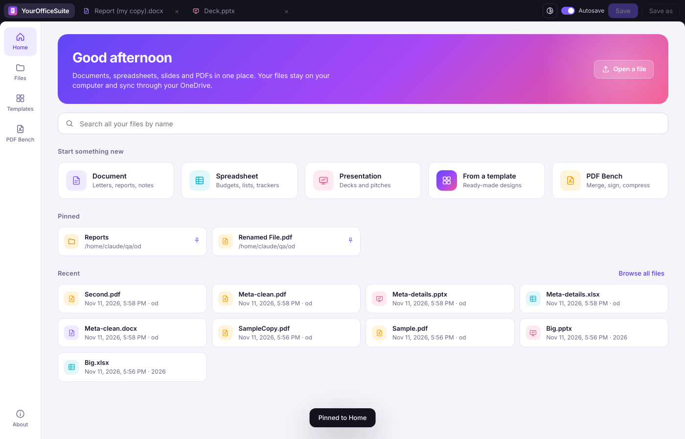
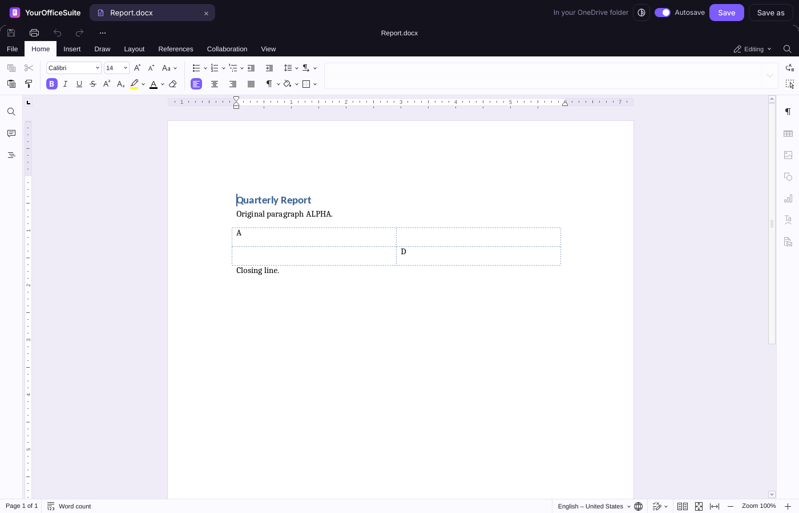
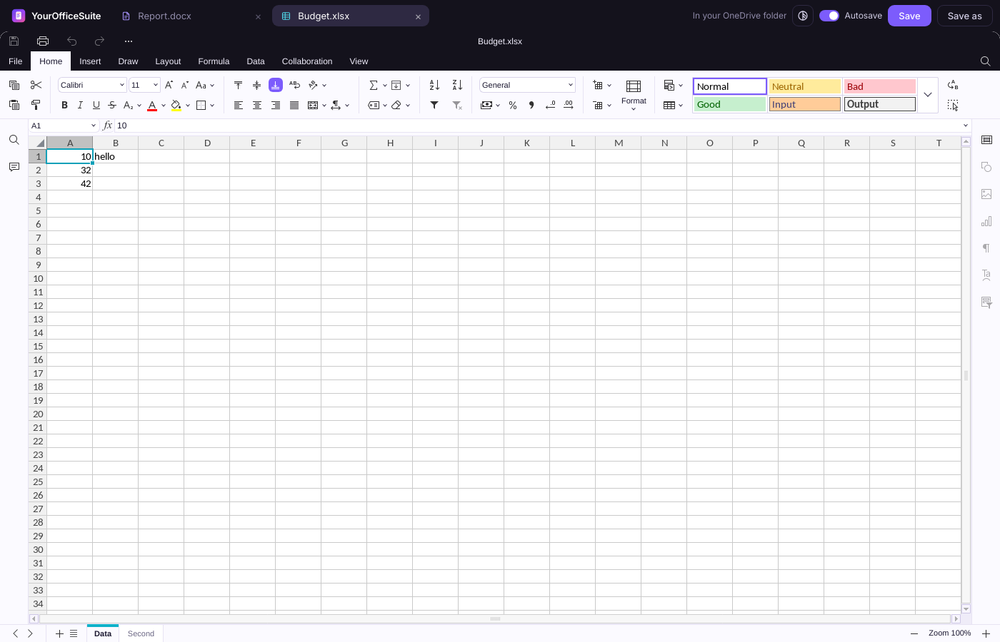
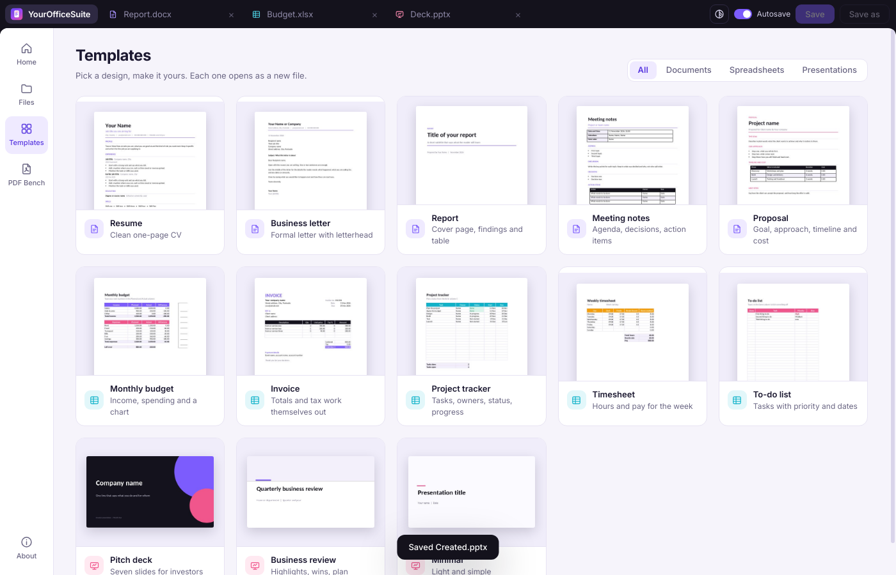
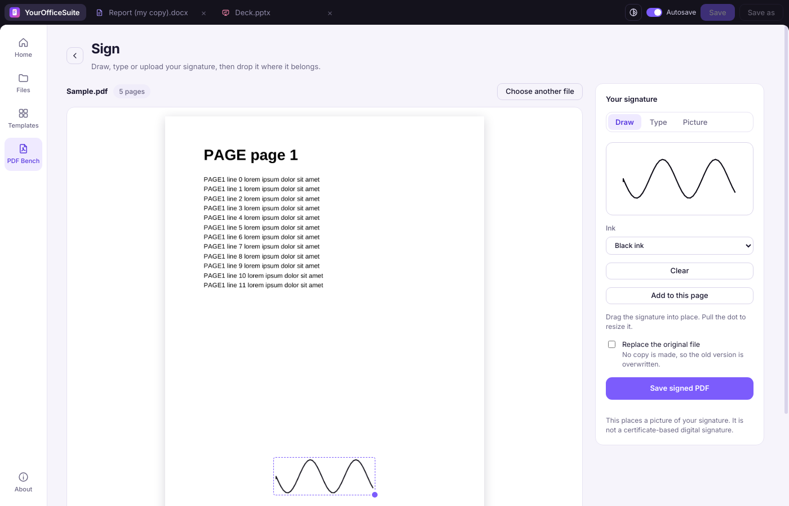
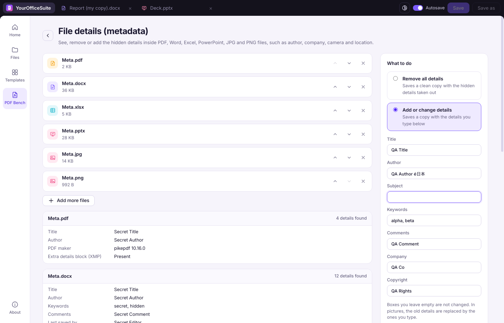
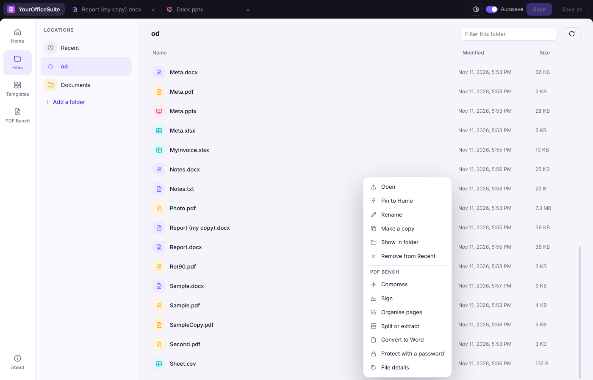
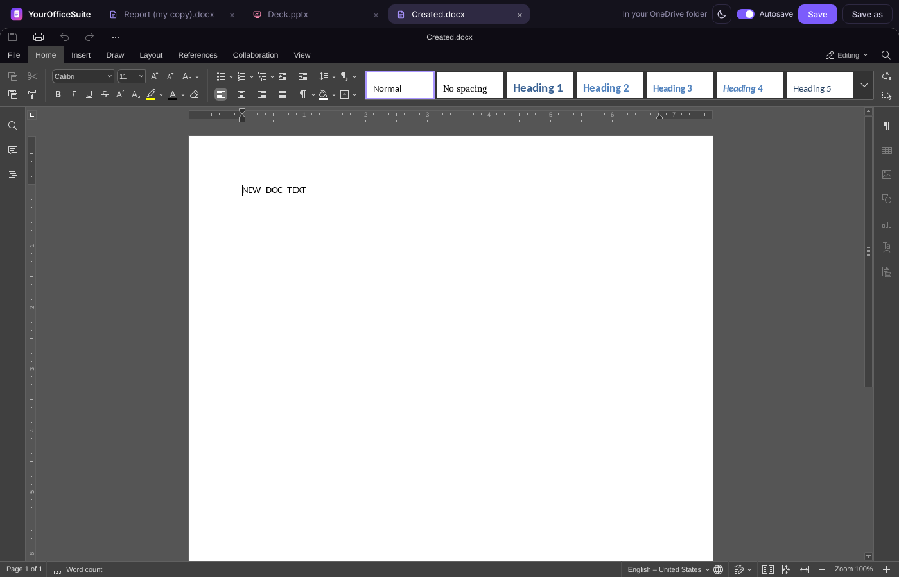

# YourOfficeSuite

**Live website:** [www.yourofficesuite.com](https://www.yourofficesuite.com/)

**Built with:** Claude Fable 5.2.

A free desktop office suite for Windows and macOS. Write documents, build spreadsheets, design presentations and handle PDFs in one app. Your files stay on your own computer and sync through your own OneDrive folder. There is no account, no ads and no tracking.

## Watch the demo

https://github.com/user-attachments/assets/ff52cefe-8715-47ec-897e-0474db99d2eb

*Press play above to watch the demo.*



**Current version: 2.3.0.** Installed and used on Windows, and backed by an automated end-to-end test suite of 73 checks.

## Contents

- [Watch the demo](#watch-the-demo)
- [What it does](#what-it-does)
- [Screenshots](#screenshots)
- [Install on Windows](#install-on-windows)
- [Install on macOS](#install-on-macos)
- [Using the app](#using-the-app)
- [Keyboard shortcuts](#keyboard-shortcuts)
- [Privacy](#privacy)
- [Build from source](#build-from-source)
- [Testing](#testing)
- [Project layout](#project-layout)
- [Licence and credits](#licence-and-credits)

## What it does

### Documents, spreadsheets and presentations

- Opens and edits Word (`.docx`), Excel (`.xlsx`, `.csv`) and PowerPoint (`.pptx`) files with full editors: styles, tables, images, formulas, charts, slide layouts, comments and more.
- Opens older formats (`.doc`, `.xls`, `.ppt`, `.odt`, `.ods`, `.odp`, `.rtf`, `.txt`) and saves them as a modern copy.
- Works in tabs, so several files can be open at once.
- 13 starter templates: resume, business letter, report, meeting notes, proposal, monthly budget, invoice, project tracker, timesheet, to-do list, pitch deck, business review and a minimal deck.

### Files and OneDrive

- Finds your OneDrive folder and edits files in place. The OneDrive app on your PC does the syncing, so no sign-in is needed inside YourOfficeSuite.
- Autosave writes changes back about five seconds after you stop typing.
- If a file changed on disk after you opened it (for example, OneDrive synced a newer version), the app offers to save a copy and leaves the other version alone.
- Search by file name across all your locations, pin files and folders to Home, and reopen the tabs you had last time.
- Right-click any file to open, pin, rename, copy, or send it to a PDF Bench tool.

### PDF Bench

Fifteen everyday tools that run on your computer. Nothing is uploaded.

| Tool | What it does |
| --- | --- |
| Merge PDFs | Join several PDFs into one, in the order you choose |
| Split or extract | Keep only the pages you tick, or save every page as its own file |
| Organise pages | Reorder, rotate and delete pages |
| Compress | Two levels: keep text selectable, or smallest possible file |
| Sign | Draw, type or upload a signature and place it on the page |
| Edit and annotate | Add text, highlights, notes and fill in forms |
| Word, Excel, PowerPoint to PDF | Convert documents to PDF |
| PDF to Word | Turn a text PDF into an editable document |
| PDF to images | Save pages as JPG or PNG |
| Images to PDF | Combine pictures into one PDF |
| Watermark | Stamp text across every page |
| Page numbers | Number the pages |
| Protect with a password | Lock a PDF with AES-256 encryption |
| Unlock | Remove a password you know |
| File details (metadata) | See, remove or add hidden details such as author, company, camera and GPS location in PDF, Word, Excel, PowerPoint, JPG and PNG files |

### Look and feel

- Its own visual identity, with light and dark themes that the editors follow.
- Works fully offline.
- Tells you when a new version is out and installs it for you.

## Screenshots

| | |
| --- | --- |
|  Document editor |  Spreadsheet editor |
|  Templates |  Sign a PDF |
|  File details (metadata) |  Right-click menu |
|  Dark theme | |

## Install on Windows

**You need:** Windows 10 or 11 (64-bit) and about 900 MB of free disk space. No administrator rights are needed.

1. Open the [latest release](https://github.com/aglr-afk/YourOfficeSuite/releases/latest) and download the `YourOfficeSuite-Setup` file (about 206 MB).
2. Run the file. If Windows shows a blue "Windows protected your PC" box, click **More info**, then **Run anyway**.
3. Follow the setup. It installs for your user only, into `%LOCALAPPDATA%\Programs\YourOfficeSuite`, and adds Start menu and desktop shortcuts.
4. Start **YourOfficeSuite**. If the OneDrive app is installed, your OneDrive folder appears under **Files**. Use **Add a folder** to add any other folder.

**Opening files from Explorer.** Setup adds YourOfficeSuite to the "Open with" list for `.docx`, `.xlsx`, `.pptx` and `.pdf`. It does not change your default apps. To make it the default, right-click a file, choose **Open with > Choose another app**, pick YourOfficeSuite and tick **Always**.

**Updating.** The app checks this project's GitHub releases when it starts. When a new version is out, Home shows a bar with what is new and an **Install** button; the app downloads the setup, checks it, and starts it for you. You can also press **Check now** in **About**, switch the automatic check off there, or point the app at a folder of setup files to update without going online.

**Uninstalling.** Use **Settings > Apps > Installed apps > YourOfficeSuite > Uninstall**. Your documents are not touched. App settings live in `%APPDATA%\YourOfficeSuite` and can be deleted by hand.

## Install on macOS

**You need:** macOS 11 or newer and about 900 MB of free disk space.

1. Open the [latest release](https://github.com/aglr-afk/YourOfficeSuite/releases/latest) and download the zip for your Mac: `mac-arm64` for Apple Silicon (M1 and newer), `mac-x64` for Intel.
2. Double-click the zip, then drag **YourOfficeSuite** into your **Applications** folder.
3. Before the first start, open **Terminal** and run this once, so macOS lets an app from outside the App Store open:

   ```bash
   xattr -cr /Applications/YourOfficeSuite.app
   ```

4. Start **YourOfficeSuite**. If the OneDrive app is installed, your OneDrive folder appears under **Files**. Use **Add a folder** to add any other folder.

**Opening files from Finder.** Right-click a `.docx`, `.xlsx`, `.pptx` or `.pdf` file and choose **Open With > YourOfficeSuite**.

**Updating.** The app checks this project's GitHub releases when it starts. When a new version is out, Home shows a bar with a **Download** button that takes you to it.

**Shortcuts.** Use `Cmd` in place of `Ctrl`.

**Uninstalling.** Drag YourOfficeSuite from Applications to the Bin. Your documents are not touched.

## Using the app

- **Start a file:** pick Document, Spreadsheet or Presentation on Home, or choose a design under Templates.
- **Open a file:** click it under Files, drop it onto Home, press `Ctrl+O`, or use the search box.
- **Save:** `Ctrl+S` saves to the same file. New files ask where to save the first time. Autosave can be switched off in the top bar.
- **PDF tools:** open PDF Bench, pick a tool and choose a file, or right-click a file anywhere in the app and pick the tool from the menu.
- **Replace the original:** most PDF tools save a new copy. Tick **Replace the original file** if you want the old version overwritten; the app asks before it does.
- **Theme:** the button in the top bar switches between following your system, light and dark.

## Keyboard shortcuts

| Keys | Action |
| --- | --- |
| `Ctrl+N` | New document |
| `Ctrl+O` | Open a file |
| `Ctrl+S` | Save |
| `Ctrl+Shift+S` | Save as |
| `Ctrl+W` | Close the current tab |
| `Ctrl+Tab` / `Ctrl+Shift+Tab` | Next / previous tab |
| `Ctrl+1` | Go to Home |
| `Ctrl+2` to `Ctrl+9` | Go to that tab |
| `F1` | Show the shortcut list |
| `Esc` | Close a menu or window |

## Privacy

- Your documents never leave your computer. The editors are served from a server that listens only on your own computer (`127.0.0.1`), and they are not allowed to reach the internet.
- The only time the app goes online is to look at this project's GitHub releases for a new version, and to download it when you choose to install. Nothing about you or your files is sent, and you can switch the check off in About.
- Each downloaded update is checked against its published SHA-256 fingerprint before it is started.
- There is no telemetry, no account and no crash reporting.
- The built-in spelling checker is switched off, because it would download dictionaries from the internet.
- PDF tools, conversions and metadata changes all run locally.
- Syncing is done by the OneDrive app you already have, not by YourOfficeSuite.

## Build from source

You need Git, Node.js 24 or newer, Python 3 and about 3 GB of free disk space. The steps below work on Linux and macOS; on Windows use WSL or Git Bash.

```bash
git clone https://github.com/aglr-afk/YourOfficeSuite.git
cd YourOfficeSuite
npm install
npm run engine      # builds the editor engine and applies this project's changes (a few minutes)
npm start           # run the app from source
```

To make the Windows installer and the macOS apps, see [docs/BUILDING.md](docs/BUILDING.md).

## Testing

The end-to-end suite in [`qa/`](qa) drives the real app with Playwright and checks results independently with Python libraries (python-docx, openpyxl, python-pptx, pypdf, pikepdf, pypdfium2, Pillow). Its 73 checks cover opening, editing and saving all three document types, templates, sync-conflict handling, every PDF Bench tool, metadata removal, search, pins, themes, session restore, shortcuts, updates and privacy. The app is also installed and used on Windows. See [docs/BUILDING.md](docs/BUILDING.md#running-the-tests) for how to run it.

## Project layout

```
main.js            Electron main process: local server, file access, settings, updates
preload.js         The small bridge the window is allowed to use
shell/             The app window: Home, Files, Templates, PDF Bench
  shell.js         Tabs, saving, search, pins, right-click menu, themes
  pdfbench.js      PDF tools
  metadata.js      File details reader and writer
  templates/       Starter templates and their previews
  vendor/          pdf-lib, PDF.js and fflate
build/             Icon, brand colour layer, template generator, installer script
scripts/           Engine download, build and patch scripts
qa/                End-to-end test suite and fixtures
docs/              Build guide and screenshots
```

The editor engine (about 540 MB) is not stored in this repository. `npm run engine` builds it from its open-source project at a pinned commit and applies the changes listed in [NOTICE.md](NOTICE.md).

## Licence and credits

YourOfficeSuite is free software under the [GNU Affero General Public License v3.0](LICENSE). You may use, share and change it under that licence. As with all software under this licence, it is provided without warranty.

It is built on other open-source projects, which keep their own licences. The document, spreadsheet, presentation and PDF editors come from ONLYOFFICE sdkjs and web-apps (AGPL-3.0, Ascensio System SIA) through the ranuts/document browser build, with the x2t converter compiled to WebAssembly. PDF Bench uses pdf-lib, PDF.js and fflate. The app shell runs on Electron. The full list, with links and the changes made, is in [NOTICE.md](NOTICE.md).

YourOfficeSuite is an independent project. It is not affiliated with or endorsed by Ascensio System SIA, Microsoft or Adobe. Product names mentioned here are trademarks of their owners.

### Contact
[Email Me](mailto:agnivabuilds@proton.me)
